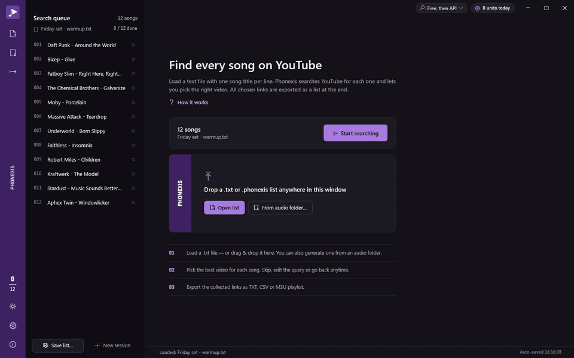
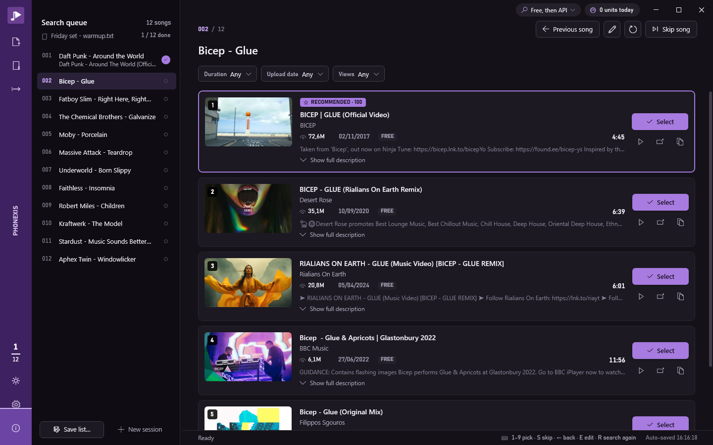
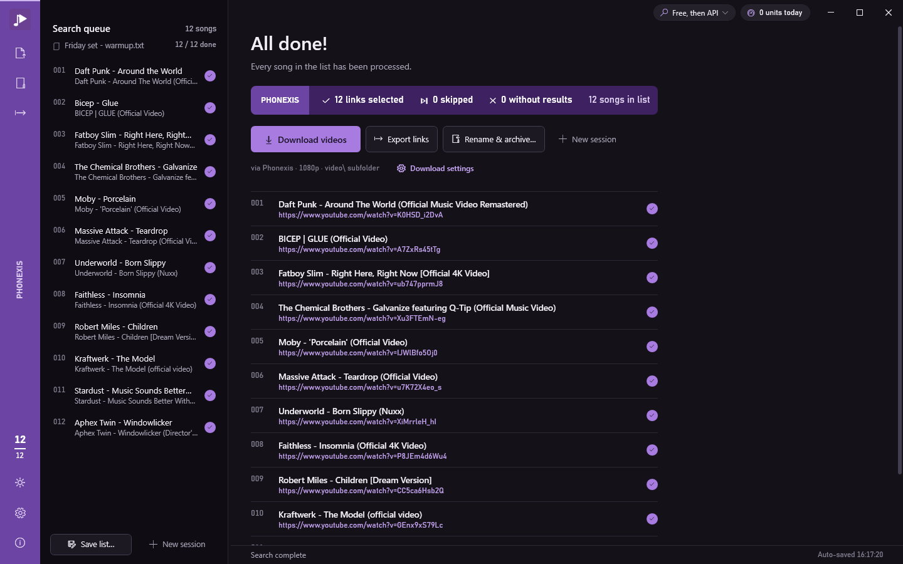

<div align="center">


# Phonexis

**Your tracklist → the right YouTube video for every song.**

Load a list of songs, pick the right video for each one in a keystroke, then export the links or download the videos named after your tracks.<br>
Built for DJs, collectors and music lovers. Free, open source, and no API key needed.

[](https://github.com/TX-Breaker/Phonexis/releases/latest)

[](LICENSE)
[](https://dotnet.microsoft.com/)
[](https://www.microsoft.com/windows)
[](CHANGELOG.md)



</div>

## What it does

1. **Load a list**: a `.txt` with one song per line, a `.phonexis` list, or generate it from a folder of audio files. Drag & drop works too.
2. **Pick the right video**: Phonexis searches YouTube for each song and preselects the most likely result. Press `Enter` to take it, `1`–`9` to choose another, `S` to skip.
3. **Export or download**: save the links as TXT, CSV or an M3U playlist, or download the videos named exactly like your tracks (`Bicep - Glue.flac` → `Bicep - Glue.mp4`).

Progress is saved on every pick, so a 400-song list can be done over several evenings.

## Highlights

- **No API key needed.** Free search uses YouTube's public search page. Add a YouTube Data API key only if you want an official backup.
- **Automatic preselection.** Every search highlights the most likely video and shows why: same name as the audio file, matching duration, artist and title words, the artist's own channel. Penalties apply to live, cover, karaoke, slowed or "1 hour" versions your list didn't ask for.
- **Made for long lists.** A catalog-numbered queue (`001`, `002`…) shows the status of every song. The purple rail on the left fills up as you work.
- **Compare at a glance.** Results show same-size thumbnails, views, upload date, source and running time on one line. Rest the pointer on a thumbnail to see frames from across the video, or preview it inside the app.
- **Videos named after your tracks.** Use the built-in downloader, yt-dlp or JDownloader, or hand the links to MediaHuman, IDM, 4K Video Downloader+ and others. *Rename & archive* then files what they saved, and every run can be undone.
- **Five languages** (English, Italiano, Deutsch, Français, Español) and **light / dark / system** themes, switchable live.

<table>
  <tr>
    <td></td>
    <td></td>
  </tr>
  <tr>
    <td align="center"><sub>One decision per song: the likely video is already highlighted</sub></td>
    <td align="center"><sub>Done: export the links or download the videos</sub></td>
  </tr>
</table>

## Download

From [Releases](https://github.com/TX-Breaker/Phonexis/releases/latest):

| File | What it is |
|---|---|
| **`Phonexis-Setup-3.0.0.exe`** | Installer. No admin rights needed: it installs for the current user (it can also install for all users). Adds a Start menu entry, an optional desktop icon and opens `.phonexis` lists with a double-click. Uninstall cleanly from Windows Settings; your settings, keys and sessions are kept. |
| **`Phonexis.exe`** | Portable single file, no installation. |

Neither needs .NET installed. Windows 10 or 11, 64-bit. The in-app preview uses Microsoft Edge WebView2, which is preinstalled on Windows 10/11.

## Search engines

Choose the engines and their order in **Settings › General**, or from the picker in the title bar:

| Mode | What happens |
|---|---|
| **Free, then API** (default) | Free search first. The API steps in only if free search fails, so no quota is spent otherwise. |
| **API, then free** | The API first. Free search takes over when keys are missing, exhausted or rejected. |
| **Free only** / **API only** | One engine, no fallback. |

- Results show where they came from: **FREE**, **API** or **CACHE**. Free results also get views and upload date, so preselection and filters work the same way.
- **When an engine fails:**
  - if the other engine answers instead, the status bar tells you;
  - if every engine fails, the error card explains why for each one and offers *Retry with …* (for this song only) or *Always try … first*.
- **When free search finds nothing:** an empty answer isn't treated as a failure, so no quota is spent on songs YouTube doesn't have. If a key is set, the card offers *Retry with YouTube API*.
- **An engine that fails 3 times in a row** is tried last for 10 minutes, so a broken engine doesn't slow down every song.

### Optional: a YouTube API key

1. Open [Google Cloud Console](https://console.cloud.google.com/) and create a project.
2. Enable **YouTube Data API v3**.
3. Create an **API key** (Credentials).
4. In Phonexis: Settings › API keys › paste › Add.

One key allows about 99 searches a day. You can add several and they rotate automatically. Keys are stored encrypted with Windows DPAPI, and repeat searches are served from the local cache for free.

## Video downloads

Picked videos can be saved next to the audio, in a `video\` subfolder, or all in one folder.

| Downloader | Level | How |
|---|---|---|
| Phonexis (built-in, YoutubeExplode + FFmpeg) | names files | In-app, with per-song progress. FFmpeg is auto-detected or downloaded on request. |
| yt-dlp | names files | Exact output path, progress shown. |
| JDownloader 2 | names files | One `.crawljob` per video in `folderwatch`. Needs the Folder Watch extension; Phonexis warns when it's missing. |
| MediaHuman YouTube Downloader | links handoff | Links go to the clipboard, the app opens and its "Paste link" button is pressed for you. |
| IDM, 4K Video Downloader+, Free Download Manager, Stacher, Parabolic, Open Video Downloader, ClipGrab, YTD, Freemake, any other | links handoff | Links go to the clipboard and to a `.txt`, then the app opens. |

- **Rename & archive** finds what any downloader saved, either by video ID or by title confirmed with the duration. It then renames and moves each file into place, and every run can be undone.
- **Dates (optional):** each video can take the creation and modification dates of its audio file.
- **Stalled downloads** (no progress for 90 s) are retried twice, then marked as failed so the queue keeps moving. *Retry failed* reruns only those.

> Please respect YouTube's Terms of Service and copyright: download only what you have the right to keep, for your own archive.

## Keyboard

| Key | Action |
|---|---|
| `Enter` | pick the recommended result |
| `1`–`9` | pick that result (numbers are shown on the thumbnails) |
| `S` or `→` | skip song |
| `B` or `←` | previous song |
| `E` | edit query |
| `R` or `F5` | search again |
| `O` | open the first result in the browser |
| `P` / `Shift+1`–`9` | preview the first / that result inside Phonexis |
| `Ctrl+O` / `Ctrl+S` / `Ctrl+E` / `Ctrl+D` | load a list / save session / export links / download videos |
| `Ctrl+Shift+S` | save the list as `.phonexis` |
| `F1` | guide |

Shortcuts pause while you type in a text box or have a drop-down open.

## Lists and data

- **`.phonexis` lists** are readable JSON. They keep what a `.txt` loses: the audio file each line came from, edited queries, picks and download state. Save one with *Save list…* (`Ctrl+Shift+S`). The audio-folder dialog saves straight to `.phonexis`.
- **Your data** (settings, encrypted keys, session, search cache, log) lives in `%LOCALAPPDATA%\Phonexis\V2`. To use a separate folder (portable use, demos, tests), start Phonexis with the `PHONEXIS_DATA_DIR` environment variable set.

## FAQ

**Do I need a Google account or an API key?**
No. Free search works out of the box. A key is an optional backup.

**What happens when free search stops working?**
In the default mode, Phonexis switches to the API on its own, if you have a key. Without a key, the error card tells you what failed and you can switch modes from the title bar.

**Does it work on macOS or Linux?**
No. Phonexis is a native Windows app (WPF).

**Where did V1 and V2 go?**
This repository is Phonexis 3. V3 keeps the V2 engine with a new interface, free search and video downloads. See [CHANGELOG.md](CHANGELOG.md).

## Build from source

```bash
git clone https://github.com/TX-Breaker/Phonexis.git
cd Phonexis
build\publish.bat          # dist\Phonexis.exe (single file, self-contained)
build\build_installer.bat  # also dist\Phonexis-Setup-3.0.0.exe (needs Inno Setup 6)
```

Requires the [.NET 8 SDK](https://dotnet.microsoft.com/download).

### Tests

```bash
dotnet test tests/Phonexis.Tests
```

xUnit tests cover:
- the search-engine chain (order, fallback, cooldown);
- video naming, `.phonexis` lists and automatic preselection;
- Rename & archive (with undo) and download robustness;
- YouTube link and storyboard parsing, and search filters.

They run offline and write only to `%TEMP%`. Set `PHONEXIS_LIVE_TESTS=1` to also run one real free search against YouTube.

### Architecture

- **.NET 8 WPF**, MVVM with CommunityToolkit.Mvvm source generators, Microsoft.Extensions.DependencyInjection
- **Search:** a chain of providers (free search via YoutubeExplode, YouTube Data API v3) with fallback and cooldown, in front of a **SQLite** cache that also does per-key quota accounting
- **DPAPI-encrypted** key store, JSON runtime localization, light/dark resource dictionaries swapped at runtime
- **YoutubeExplode + FFmpeg** for the built-in downloader and previews, **WebView2** for the preview player
- The "Obi" design system is documented in [DESIGN.md](DESIGN.md)

```
src/Phonexis/
├── Models/        SongItem, SearchResult, SearchEngine, SessionState, AppSettings, DownloadOptions
├── Services/      YouTubeService, CacheService, ApiKeyStore, SessionService, ListFileService,
│                  ResultRanker, SettingsService, ThemeService, I18n, LogService
│   ├── Search/    SearchChain, FreeSearchProvider
│   ├── Downloads/ downloaders (built-in, yt-dlp, JDownloader, link handoff), naming, Rename & archive
│   └── Previews/  storyboard frames for hover previews
├── ViewModels/    MainViewModel (+ Search, Downloads, Keyboard, Lists, Preselect partials)
├── Views/         Settings, About, EditQuery, FilenameExtractor, Archive, Onboarding, Preview dialogs
├── Helpers/       converters, Motion (animations), WindowChromeHelper, ThumbnailPreview
├── Themes/        Colors.Light / Colors.Dark / Styles
└── Resources/     i18n dictionaries (en/it/de/fr/es), logo, icon
tests/Phonexis.Tests/   xUnit tests
build/                  publish and installer scripts (Inno Setup)
```

## License

MIT. See [LICENSE](LICENSE).

---

<div align="center">

**Made with 💜 by TX-Breaker** · [Report a bug](https://github.com/TX-Breaker/Phonexis/issues) · [MetaGroove](https://github.com/TX-Breaker/MetaGroove)

</div>
